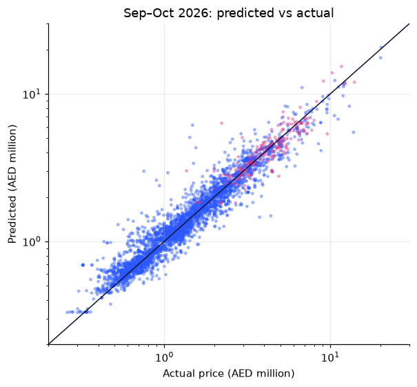
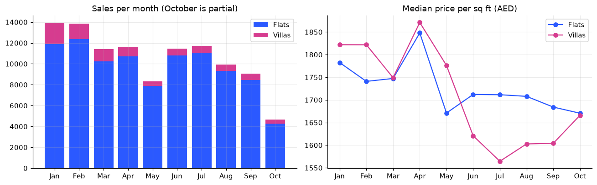
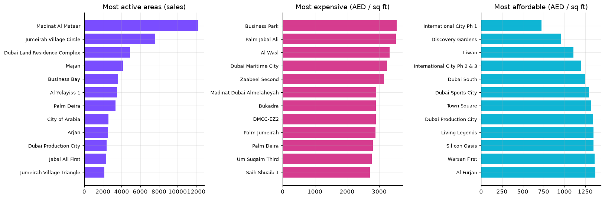
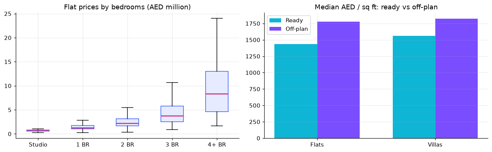
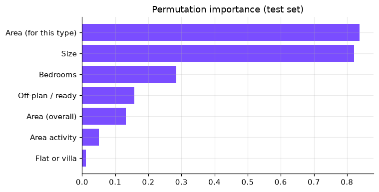

# Dubai Property Price Estimator 🏙️

What is a fair price for an apartment or villa in Dubai? This project analyses **105,986 real sales** registered with the **Dubai Land Department (DLD)** in 2026 and trains a machine-learning model that estimates a property's price from its area, type, bedrooms, size and off-plan status.

**🔗 Live app:** https://dubai-property-price-estimator.vercel.app
**👤 Portfolio:** https://priyanshu-zihowa.vercel.app


---

## Results

The model was trained on **January–August 2026** sales and tested on **September–October 2026** sales it had never seen, the same situation as predicting tomorrow's sales from yesterday's data.

| Method | Median error | Within 10% | Within 20% | R² (log price) |
|---|---|---|---|---|
| Baseline: area's median price per sq ft × size | 11.1% | 46% | 71% | 0.883 |
| **Gradient boosting (this model)** | **8.3%** | **57%** | **83%** | **0.934** |

* Tested on **13,721** sales (12,714 apartments, 1,007 villas). Villas: 8.1% median error.
* Every estimate in the app comes with a **likely range** (the middle 80% of test errors: about −18% to +18%).



---

## What the data shows (Jan–Oct 2026)

* **AED 197.8 billion** of residential sales: 96,970 apartments and 9,016 villas.
* Median price: **AED 1,722 per sq ft** for apartments and **AED 1,772** for villas.
* **About 3 in 4 sales were off-plan**: buyers purchasing before the building is finished.





---

## How it works

### 1. Cleaning
| Rule | Why |
|---|---|
| Keep residential **flats** and **villas** | offices, shops, land and hotel rooms are priced differently |
| Keep real **sale procedures** | lease-to-own and bulk developer registrations aren't market sales |
| Realistic sizes (flats 200–6,000 sq ft, villas 700–20,000 sq ft) and price ≥ AED 100,000 | removes entry errors and symbolic transfers |
| Drop the most extreme 0.5% of prices per sq ft on each side | removes outliers |
| Normalise area names (`BUSINESS BAY` → `Business Bay`) | the raw data mixes upper and title case |

129,748 transactions → **105,986 clean sales** across 143 areas.

### 2. Features
| Feature | Meaning |
|---|---|
| Area value | smoothed average log price per sq ft of the area (target encoding) |
| Area value for this type | the same, for apartments or villas separately |
| Area activity | how many sales the area had |
| Flat or villa, off-plan or ready, bedrooms | from the transaction |
| Size | log of the size in sq ft |

**Smoothed target encoding:** instead of 140+ yes/no columns for areas, each area becomes one number: its typical price per sq ft, pulled towards the city average when an area has few sales, so a handful of sales can't dominate.

### 3. Model
A scikit-learn **HistGradientBoostingRegressor** (400 trees, max 31 leaves) predicts the **log of the price per sq ft**; the price is `exp(prediction) × size`. Predicting price *per sq ft* keeps the target on a similar scale for a studio and a mansion.



The area and the size explain most of the price; bedrooms and off-plan status refine it.

### 4. Running in the browser
The trained trees are exported to JSON (~1 MB) and evaluated by about ten lines of JavaScript. I checked that the JavaScript gives **exactly** the same predictions as scikit-learn. No server or API, so estimates update instantly as you type.

---

## What I learned

* **Always beat a baseline.** A one-line rule ("area median × size") already gets within 20% on 71% of sales; the model is worth it because it takes that to 83%.
* **Split by time, not at random.** A random split would let the model see sales from the same weeks it is tested on. Training on Jan–Aug and testing on Sep–Oct is the honest test.
* **Remove features that don't help.** The month of sale had zero importance, so it was dropped and the model got simpler with no loss in accuracy.
* **Exported models must be checked.** The first export rounded the tree thresholds and predictions drifted by up to 2%. Exporting full-precision thresholds made them identical.

## Limitations
* It only knows the inputs above. View, floor, building age, finishing and exact location inside an area all affect real prices.
* Data covers 1 January to 15 October 2026; the market moves, so estimates age.
* Areas with fewer than 25 sales are not offered, and areas with few villas or apartments show a warning.
* This is a student project, **not a valuation or financial advice**.

---

## Project structure

```
dubai-property-price-estimator/
├── analysis/
│   ├── dubai_property.ipynb   # cleaning, charts, model, evaluation, export (start here)
│   └── dubai_property.py      # the same notebook as a plain Python script
├── web/                       # the live app (HTML, CSS, JavaScript, Chart.js)
│   ├── app.js                 # form, tree-walking model, charts
│   └── data/                  # model.json, areas.json, dashboard.json, metrics.json
├── docs/                      # charts and screenshot used in this README
└── requirements.txt
```

## Run it yourself

1. Download the **Transactions** CSV from the [DLD Real Estate Data page](https://dubailand.gov.ae/en/open-data/real-estate-data/) (filter: Sales) into `data/`. The raw data is not included in this repository.
2. Install and run the notebook:

```bash
pip install -r requirements.txt
```

Open `analysis/dubai_property.ipynb` and run all cells. It rewrites the files in `web/data/`.

3. Serve the app:

```bash
python -m http.server 5501 --directory web
```

---

## Tech
Python · pandas · scikit-learn · Matplotlib · JavaScript · Chart.js · Vercel

## Credits
* Data: **Dubai Land Department**, [Real Estate Data](https://dubailand.gov.ae/en/open-data/real-estate-data/) (open data). This is an independent project, not affiliated with DLD.
* Built by **Priyanshu Zihowa**, with Claude Code as a coding assistant.

## License
MIT (code). The underlying data belongs to the Dubai Land Department.
